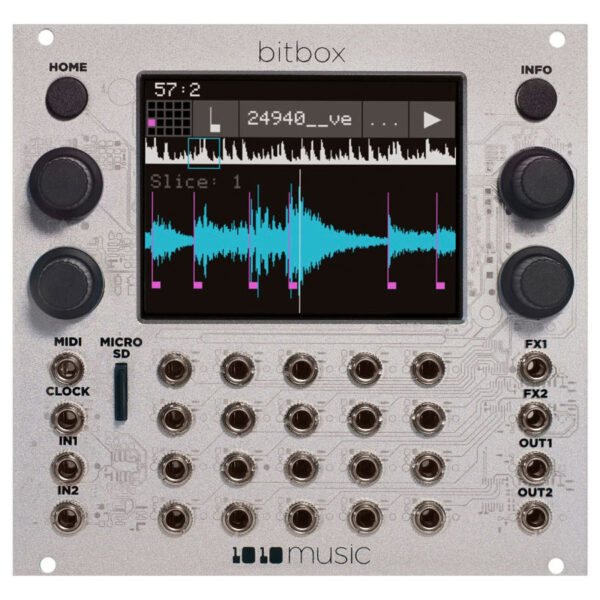

# Ideas

## Create Generic Eurorack based on rasperry pi compute 4
- Should look along the lines of the 1010music  bitbox mk2  bitbox mk2

### Concept
A **generic, software-defined Eurorack module**: one hardware platform (CM4 + touchscreen + audio/CV I/O) that can become a sampler, multi-FX, sequencer, looper, granular engine, etc. depending on the app it loads. Like the bitbox, it's touch-first, with a few knobs and jacks for hands-on control and patching.

**Design goals**
- Touchscreen UI plus a few physical controls (encoders and buttons) for live use
- Audio-rate I/O that can also carry DC CV, plus dedicated gate/trigger I/O
- Survives having the case switched off without warning (no corrupted SD card)
- Boots fast enough to be usable on stage (aim for under 10 s)
- An open app framework, so new "personalities" don't need new hardware

### Target hardware spec (first draft)
| Area | Proposal | Notes |
|---|---|---|
| Compute | Raspberry Pi **CM4** (2–4 GB RAM, 8–16 GB eMMC) | Consider **CM5**, which is mostly pin-compatible and faster. Keep the footprint open for it. |
| Size | ~26–30 HP, 3U (128.5 mm tall panel), depth under 45 mm if possible | 1 HP = 5.08 mm. Check the CM4 + carrier + display stack height early. |
| Display | 4.3"–5" 800×480 capacitive touch over **MIPI DSI** | DSI avoids burning CPU on SPI display updates. |
| Audio codec | **CS42448** (6 in / 8 out, TDM) or **AK4619** (4 in / 4 out) | TDM over the Pi's I2S. CS42448 already has a Linux driver (Audio Injector Octo). |
| Analog front end | Op-amp scaling of ±5 V Eurorack audio (10 Vpp) to codec line level, with clamping/protection | Use TL07x or OPA16xx-class op-amps. |
| CV in | 4–8 × DC-coupled inputs, ±5 V / 0–10 V, via a precision ADC | Codec inputs are usually AC-coupled, so CV needs its own path. |
| CV out | 4 × DC outputs via a DAC (e.g. DAC8564 / MCP4728) + op-amp to ±5 V/±10 V | Calibrate 1 V/oct per channel. |
| Gates | 2–4 gate/trigger ins (comparator/transistor), 2–4 gate outs | |
| Controls | 3–4 push encoders, 2–4 buttons | |
| Co-processor | **RP2040** or small STM32 over SPI/UART | Handles CV/gate/encoder scanning with tight timing so Linux doesn't have to. |
| Storage | eMMC for the OS (read-only), **microSD or USB** for samples/presets | |
| Connectivity | USB-A host (MIDI controllers, sticks), USB-C device (MIDI/audio), optional TRS MIDI, Wi-Fi for transfers | |
| Power | Eurorack 16-pin; **buck converter from +12 V → 5 V** (≥2.5 A) | Don't rely on the case's +5 V rail. Expect ~600–900 mA on +12 V; publish the real figures. |

### Software architecture
- **OS**: Buildroot (or Raspberry Pi OS Lite, stripped down) with a **PREEMPT_RT** kernel, **read-only root filesystem**, and a separate writable data partition with safe-write handling
- **Audio**: direct ALSA (or JACK) at 48 kHz, 64–128 frame buffers. Target under 5 ms round-trip latency
- **Engine**: C++ audio host with a plugin/"app" API. Optionally reuse DSP from Faust, Pure Data (libpd), or SuperCollider for fast prototyping
- **UI**: LVGL or Qt Quick on DRM/KMS (no desktop), in a separate process from the audio thread
- **Co-processor firmware**: streams CV/gate/encoder state at ≥1 kHz and accepts CV/gate output frames
- **Apps to start with**: 1) sample player/sampler (bitbox-style pad grid), 2) stereo multi-FX, 3) step sequencer driving CV/gate outs

### Practical implementation plan

**Phase 0 – Requirements & research (1–2 weeks)**
- [ ] Lock down the I/O count, HP width, and the first 1–2 apps
- [ ] Study similar devices: bitbox mk2, Bela, Organelle, Monome Norns, Rebel Technology, Percussa SSP (also ARM + Linux + Eurorack)
- [ ] Check CM4 stock/pricing and CM5 compatibility; decide which to target
- [ ] Measure a real bitbox (or its spec sheet) for panel layout and depth reference

**Phase 1 – Breadboard prototype with off-the-shelf parts (3–4 weeks)**
- [ ] Raspberry Pi 4 (same SoC as CM4) + **Audio Injector Octo** (CS42448) or a HiFiBerry DAC+ADC
- [ ] Official 5" DSI touchscreen
- [ ] RP2040 Pico + MCP3208 ADC + MCP4728 DAC on a breadboard for CV
- [ ] Build an RT kernel, measure latency and xruns under load
- [ ] Get a "hello world" sampler running: touch a pad → play a sample → gate in triggers it
- **Exit criteria**: stable audio at 128 frames with no xruns over 1 hour, CV/gates working

**Phase 2 – Eurorack analog front end (3–4 weeks)**
- [ ] Design and simulate (LTspice) the input/output scaling, protection, and CV DAC output stages
- [ ] Make a small "I/O test board" PCB (KiCad, JLCPCB/PCBWay) that connects to the Pi 4 prototype
- [ ] Test it in a real case: noise floor, crosstalk, 1 V/oct accuracy, behavior with reverse/over-voltage
- **Exit criteria**: under 1 mV CV error after calibration, no audible noise from the display or CPU

**Phase 3 – Custom CM4 carrier board rev A (4–6 weeks + fab time)**
- [ ] KiCad design: CM4 connectors (Hirose DF40), 12 V→5 V buck, codec, analog front end, RP2040, USB, DSI connector
- [ ] Split into **two stacked boards**: a digital/CM4 board and a panel/analog board (jacks, pots, encoders), connected by board-to-board headers
- [ ] Ground planning: keep the audio ground separate and star-connected, and keep the buck converter away from the analog section
- [ ] Order assembled PCBs (JLC PCBA) with 3–5 units
- **Exit criteria**: boots, audio and CV work, fits within HP and depth limits

**Phase 4 – Panel & mechanics (in parallel with Phase 3)**
- [ ] Panel design in KiCad/Inkscape: aluminium PCB panel or 2 mm anodized aluminium
- [ ] Display mounting bracket (3D-printed first, then machined/sheet metal)
- [ ] Check thermals: the CM4 needs a thin heatsink, and the case has limited airflow

**Phase 5 – Software platform (ongoing from Phase 1)**
- [ ] Buildroot image: fast boot, read-only rootfs, OTA/USB update path
- [ ] Audio host + app API, preset/sample browser, settings, and a CV calibration routine
- [ ] Ship the first app (sampler) at "usable" quality, then multi-FX and sequencer
- [ ] Power-loss test: pull power 100× mid-write; nothing should corrupt

**Phase 6 – Rev B & polish**
- [ ] Fix rev A issues, reduce noise and current draw, final panel graphics
- [ ] Documentation, open-source repos (hardware + software), optional small production run

### Rough BOM estimate (prototype, per unit)
| Item | Approx. cost |
|---|---|
| CM4 / CM5 (4 GB, eMMC) | €60–90 |
| 5" DSI touchscreen | €40–70 |
| Codec + analog parts + ADC/DAC | €20–35 |
| RP2040, power, connectors, jacks, encoders | €25–40 |
| PCBs + assembly (small batch) | €30–60 |
| Panel + mechanics | €20–40 |
| **Total** | **~€195–335** |

### Key risks
- **Depth**: CM4 + carrier + display may exceed skiff depth. Prototype the stack early
- **Noise**: digital and switching noise getting into the audio/CV paths. Use good layout, filtering, and a separate analog supply
- **Latency/jitter on Linux**: use the RT kernel, CPU isolation for the audio thread, and the co-processor for timing-critical I/O
- **Boot time & power loss**: use a read-only rootfs and keep Buildroot minimal
- **Current draw**: high +12 V draw can be a problem for small cases

### Open questions
- Which app matters most: sampler, FX, or sequencer?
- Mono or stereo I/O count? Is 4 in / 4 out audio enough?
- Fully open source, or a personal one-off?
- Is CM5 worth the extra power/heat?
